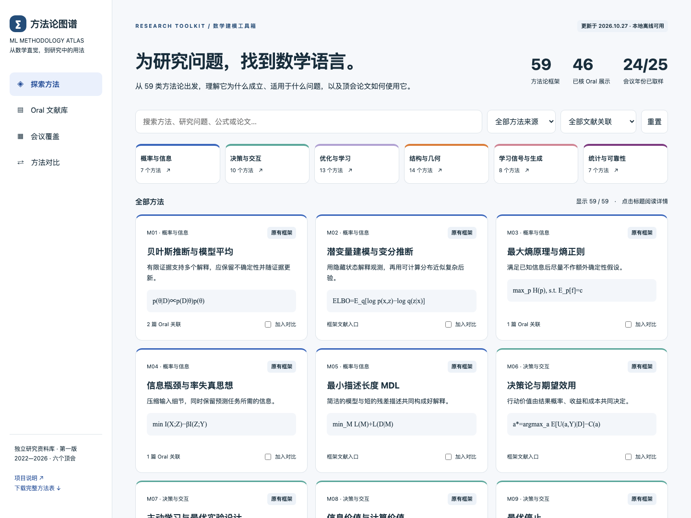

# ML Methodology Atlas · 机器学习方法论图谱

**原30类扩充到59类；收录46篇已核官方Oral展示论文及1篇待核候选，覆盖2022–2026六个顶会的24/25个举办年份单元。** 第一版，更新2026-10-27。

核心产物是方法论表：数学框架、直觉、适用问题、成立条件、失效边界和实际论文中的用法。保留原30类稳定编号；补充20类基础框架，并从本轮论文中拆出9类独立有用的框架。

## 可视化前端

**[在线访问方法论图谱](https://dsadd4.github.io/ml-methodology-atlas/)** · 无需下载，直接在浏览器使用。

[打开离线前端](frontend/index.html)：方法搜索、六大分类、详情来源、最多三方法对比、论文库、可点击会议覆盖矩阵。可直接双击使用。

本地预览：http://127.0.0.1:8768/frontend/index.html 。重建：`python scripts/build_frontend.py`；检查：`python scripts/check_frontend.py`。静态概览导出位于 `frontend/exports/`。

## 阅读入口

- [59类总表](METHODS.md)：先看全貌。
- [59张详细方法卡](METHOD_CARDS.md)：条件、区别、基础文献与Oral实例。
- [Oral论文索引](ORAL_PAPERS.md)：会议、年份、官方来源和阅读深度。
- [论文方法卡](PAPER_CARDS.md)：逐篇机制、假设、失效条件与部分实验建议。
- [年份覆盖](COVERAGE.md)：哪些年份已经取样、哪些仍有缺口。
- [独立复核](research/independent_review.md)及[数据验收](VALIDATION.md)。

## 本版新增方向

M31–M50涵盖博弈均衡、机制设计、在线学习、Bandit、序贯检验、信息几何、镜像下降、近端方法、不动点、算子学习、谱方法、流形、拓扑、逆问题、流匹配、Schrödinger桥、GFlowNet、重要性采样、蒸馏、正交估计。

M51–M59进一步加入进化搜索与质量多样性、Markov生成元、凸松弛、隐式正则、归一化流、偏好学习、差分隐私、图团搜索、Wasserstein梯度流。

这些是可组合且有层级关系的建模标签，并非互斥理论。不是每类都有本轮Oral实例。官方身份已核实与正文方法已精读也分开记录；目前主要完成摘要层筛选，3篇定位阅读方法段。这里没有宣称完成五年所有Oral普查。

## 下载与启动

```bash
git clone https://github.com/Dsadd4/ml-methodology-atlas.git
cd ml-methodology-atlas
python3 -m http.server 8768 --bind 127.0.0.1
```

在浏览器打开 http://127.0.0.1:8768/frontend/index.html 。也可以直接打开下载后的 `frontend/index.html`，页面自带数据，无需安装依赖。



修改数据后，依次运行：

```bash
python3 scripts/build_catalog.py
python3 scripts/build_frontend.py
```

可选的浏览器交互检查与图片导出使用 Playwright：

```bash
python3 -m pip install playwright
python3 -m playwright install chromium
python3 scripts/check_frontend.py
python3 scripts/export_overview.py
```

## 数据与维护

主数据：[methods.json](data/methods.json)、三个会议分组JSON、[映射表](data/paper_method_map.json)。导出：[methods.csv](data/methods.csv)、[papers.csv](data/papers.csv)、[papers.json](data/papers.json)。CSV使用UTF-8 BOM便于表格软件读取。

运行 `python scripts/build_catalog.py` 重建所有目录与卡片。只用Python标准库；构建同时检查唯一ID、必填字段、年份和映射引用。`methods_seed.tsv`是原50类输入快照（使用¦分隔），不是维护入口。

三路并行调研：ICLR、NeurIPS/ICML、CVPR/ICCV/ECCV；另由ICLR调研者对视觉初始14篇身份及M31–M50作交叉复核。详见research下分工报告。论文发现脚本原始结果保留，但其命中不是Oral身份依据。

下一版最有价值的工作是对现有卡逐步补全文方法依据、反例与最小可运行示例，再扩大尚无实例的方法覆盖。项目未进行模型实验。
